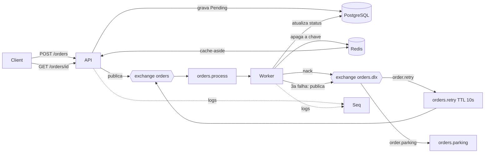

# Orders Mini


API de pedidos com processamento assíncrono em .NET 10. A API recebe o pedido, grava no PostgreSQL e publica uma mensagem no RabbitMQ. Um worker consome a mensagem com confirmação manual (ack), faz retry com atraso, manda para uma parking queue quando esgota as tentativas, e mantém o cache do Redis consistente. Cada requisição carrega um correlation id que aparece nos logs da API e do worker no Seq.

O projeto foi feito para demonstrar, de forma testável, quatro coisas: mensageria com tratamento de falhas, cache e idempotência com Redis, logging estruturado, e testes unitários e de integração.

## Arquitetura



O caminho de um pedido:

1. `POST /orders`: a API grava o pedido como `Pending` no PostgreSQL, publica `OrderCreated` no RabbitMQ e responde `202 Accepted` com o `OrderId`, sem esperar o processamento.
2. O worker recebe a mensagem, marca o pedido como `Processing`, processa e marca `Completed`. Só então confirma a mensagem (ack).
3. Se o processamento falha, o worker rejeita a mensagem (nack). Ela vai para a exchange `orders.dlx`, espera 10 segundos na fila `orders.retry` e volta para `orders.process`. Na terceira falha, o pedido vira `Failed` e a mensagem é publicada na `orders.parking`.
4. A cada mudança de status, o worker apaga a chave do pedido no Redis.
5. `GET /orders/{id}`: a API procura no Redis; se não achar, lê o PostgreSQL e guarda o resultado por 60 segundos.

## Tecnologias

- .NET 10, ASP.NET Core (minimal API) e Worker Service
- RabbitMQ 4 (cliente RabbitMQ.Client 7)
- PostgreSQL 17 com Entity Framework Core e migrations
- Redis 7 (StackExchange.Redis)
- Serilog com Seq
- xUnit e Testcontainers
- Docker Compose e GitHub Actions

## Estrutura

```
src/
  Orders.Api/          API HTTP
  Orders.Worker/       consumer do RabbitMQ
  Orders.Contracts/    mensagem, topologia do RabbitMQ e chaves de cache
  Orders.Data/         entidade, DbContext e migrations
tests/
  Orders.UnitTests/
  Orders.IntegrationTests/
```

## Como rodar

Requisito: Docker Desktop. Na raiz do repositório:

```
docker compose up -d --build
```

O primeiro build leva alguns minutos. Depois disso:

| Serviço | Endereço |
| --- | --- |
| API | http://localhost:5080 |
| Seq (logs) | http://localhost:5340 |
| Painel do RabbitMQ | http://localhost:15672 (guest / guest) |

Criar um pedido (PowerShell):

```
Invoke-RestMethod -Method Post -Uri http://localhost:5080/orders -ContentType "application/json" -Body '{"customer":"Ana","amount":99.90}'
```

Ou com curl:

```
curl -X POST http://localhost:5080/orders -H "Content-Type: application/json" -d '{"customer":"Ana","amount":99.90}'
```

A resposta é `202` com `{ "orderId": "..." }`. Consulte o pedido em `GET http://localhost:5080/orders/{orderId}`.

Para parar: `docker compose down`. Com `-v`, os dados dos volumes também são apagados.

### Rodando a API e o worker fora do Docker

Útil para depurar. Requisito: .NET 10 SDK. Suba só a infraestrutura:

```
docker compose up -d --wait rabbitmq postgres redis seq
```

E, em dois terminais:

```
dotnet run --project src/Orders.Worker
dotnet run --project src/Orders.Api --urls http://localhost:5080
```

O `appsettings.json` de cada projeto já aponta para `localhost` nas portas publicadas pelo compose (PostgreSQL `55432`, Redis `6380`, RabbitMQ `5672`, Seq `5341`). Pare antes os contêineres `api` e `worker`, se estiverem rodando, para não duplicar a porta `5080` nem os consumers. O campo `failureMode` só funciona em Development; se ele for ignorado, confira que `ASPNETCORE_ENVIRONMENT` está como `Development`.

## API

| Método e rota | Descrição |
| --- | --- |
| `POST /orders` | Cria um pedido. Corpo: `{ "customer": "Ana", "amount": 99.90, "failureMode": "None" }` (`failureMode` é opcional). |
| `GET /orders/{id}` | Consulta um pedido, com cache no Redis. |

Cabeçalhos opcionais do `POST /orders`:

- `Idempotency-Key`: até 100 caracteres. Repetir a mesma chave devolve o pedido já criado, sem criar outro.
- `X-Correlation-Id`: até 100 caracteres. Se ausente, a API gera um. O valor volta no cabeçalho da resposta.

Respostas do `POST /orders`: `202` com `{ "orderId": "..." }`, `400` se a `Idempotency-Key` for longa demais e `409` no caso raro de a chave de idempotência expirar durante a requisição repetida.

Resposta do `GET /orders/{id}`: `200` com `id`, `customer`, `amount`, `status`, `attempts`, `lastError`, `createdAtUtc` e `updatedAtUtc`, ou `404` se o pedido não existir (o 404 não é cacheado).

Estados do pedido:

| Status | Significado |
| --- | --- |
| `Pending` | Criado pela API, ainda não pego pelo worker. |
| `Processing` | O worker está processando. |
| `Completed` | Processado com sucesso. |
| `Retrying` | Falhou e aguarda a próxima tentativa. |
| `Failed` | Esgotou as 3 tentativas; a mensagem está na parking queue. |

## Topologia do RabbitMQ

Todas as exchanges são `direct` e duráveis, as filas são duráveis e as mensagens são persistentes. A API e o worker declaram a topologia ao iniciar.

| Item | Ligação | Argumentos e função |
| --- | --- | --- |
| Exchange `orders` | | Recebe os pedidos publicados pela API. |
| Exchange `orders.dlx` | | Recebe as mensagens rejeitadas, expiradas ou enviadas ao parking. |
| Fila `orders.process` | `orders` com a chave `order.created` | Fila principal, lida pelo worker. Em caso de nack, a mensagem vai para `orders.dlx` com a chave `order.retry`. |
| Fila `orders.retry` | `orders.dlx` com a chave `order.retry` | Sem consumer. TTL de 10 segundos; ao expirar, a mensagem volta para `orders` com a chave `order.created`. |
| Fila `orders.parking` | `orders.dlx` com a chave `order.parking` | Sem consumer. Guarda as mensagens que esgotaram as tentativas, com os cabeçalhos `x-attempts` e `x-last-error`. |

## Configuração

Os valores padrão ficam no `appsettings.json`, e variáveis de ambiente os substituem (o `__` representa os dois pontos da hierarquia). O `docker-compose.yml` usa isso para apontar API e worker para os serviços pelo nome.

| Variável | Uso |
| --- | --- |
| `ConnectionStrings__Orders` | Conexão com o PostgreSQL. |
| `ConnectionStrings__Redis` | Endereço do Redis. |
| `RabbitMq__HostName`, `RabbitMq__Port`, `RabbitMq__UserName`, `RabbitMq__Password`, `RabbitMq__VirtualHost` | Conexão com o RabbitMQ. |
| `Seq__ServerUrl` | Endereço de envio dos logs. |
| `ASPNETCORE_ENVIRONMENT` | `Development` habilita o `failureMode` na API. |

## Cenários de falha

O campo `failureMode` do `POST /orders` simula falhas no worker. Ele só vale em ambiente Development (o compose sobe nesse modo, para demonstração):

| Valor | Comportamento |
| --- | --- |
| `None` | Processa em 2 segundos. |
| `Slow` | Demora 30 segundos, o que dá tempo de derrubar o worker no meio. |
| `Transient` | Falha nas duas primeiras tentativas e funciona na terceira. |
| `Permanent` | Falha sempre. |

Todos os cenários aceitam o cabeçalho `X-Correlation-Id`. No Seq, buscar `CorrelationId = '<valor>'` mostra a história completa do pedido, da API ao worker.

### 1. Falha permanente vai para a parking queue

```
Invoke-RestMethod -Method Post -Uri http://localhost:5080/orders -ContentType "application/json" -Headers @{ "X-Correlation-Id" = "demo-permanente" } -Body '{"customer":"Bia","amount":50.00,"failureMode":"Permanent"}'
```

Em cerca de 30 segundos: o pedido fica `Failed` com `attempts = 3` e `lastError` preenchido, e a mensagem aparece na fila `orders.parking` (painel do RabbitMQ, em Queues, `Get messages`), com os cabeçalhos `x-attempts` e `x-last-error`. No Seq, as três tentativas aparecem com o mesmo `CorrelationId`.

### 2. Falha transitória se recupera

Use `"failureMode":"Transient"`. As duas primeiras tentativas falham e passam pela fila de retry. Na terceira o pedido fica `Completed`, com `attempts = 3`.

### 3. O worker cai no meio do processamento

Crie um pedido `Slow` e, durante os 30 segundos, rode:

```
docker compose stop worker
```

A mensagem não foi confirmada, então o RabbitMQ a devolve à fila. Suba o worker de novo com `docker compose start worker`: a mensagem chega marcada como `Redelivered` e o pedido é processado.

### 4. Idempotência na API

Mande a mesma requisição duas vezes com o mesmo `Idempotency-Key`:

```
$headers = @{ "Idempotency-Key" = "pedido-abc-123" }
Invoke-RestMethod -Method Post -Uri http://localhost:5080/orders -ContentType "application/json" -Headers $headers -Body '{"customer":"Caio","amount":10.00}'
```

As duas respostas trazem o mesmo `orderId`, só um pedido existe no banco e o worker processa uma vez. A chave fica guardada no Redis por 24 horas (`idempotency:<chave>`).

### 5. Cache consistente

Crie um pedido `Slow` e consulte-o enquanto está `Processing`: o resultado fica no Redis. Quando o worker conclui, ele apaga a chave, e a próxima consulta já mostra `Completed`. Nos logs da API (`docker compose logs api`) aparecem os eventos `Cache HIT` e `Cache MISS`.

## Decisões de design

- **Ack manual, com o status gravado antes do ack.** Se o worker cair entre gravar e confirmar, o pior caso é uma mensagem entregue de novo (duplicata, que o worker detecta pelo status), e não um pedido perdido. É a semântica at-least-once.
- **Retry com fila de espera (TTL) e dead-letter exchange.** Devolver a mensagem direto à fila principal causaria um loop apertado. Com a fila de espera, cada tentativa tem um intervalo de 10 segundos, e o número da tentativa vem do cabeçalho `x-death` que o próprio RabbitMQ mantém.
- **Parking queue.** Mensagens que esgotam as tentativas saem do fluxo e ficam guardadas, com o número de tentativas e o último erro, para análise manual.
- **Cache-aside com TTL de 60 segundos e invalidação feita pelo worker.** O worker apaga a chave depois de gravar no banco, e não antes: se apagasse antes, uma leitura no meio recriaria o cache com o valor antigo. Se o Redis estiver fora do ar, o worker só registra um aviso, porque o cache é um apoio, e o TTL limita o tempo de um dado velho.
- **Idempotência na API com `SET NX EX`.** Verificar e gravar numa única operação atômica evita que duas requisições simultâneas criem dois pedidos. Se a criação falha, a chave é apagada para o retry do cliente funcionar.
- **Idempotência no consumidor.** O worker confere se o pedido já está `Completed` antes de processar. Isso trata a duplicata que o RabbitMQ pode gerar, uma proteção diferente da idempotência da API.
- **Registrar a falha não pode quebrar o tratamento da mensagem.** Se o banco estiver fora do ar, o worker ainda assim decide entre retry e parking.
- **Um `DbContext` por mensagem** (`IDbContextFactory`), porque o `DbContext` não é thread-safe.
- **Correlation id dentro da mensagem.** API e worker são processos separados, e a mensagem é a única coisa que viaja entre eles. O id nasce na API (ou vem do cabeçalho `X-Correlation-Id`), vai na propriedade `CorrelationId` da mensagem e entra no `LogContext` do Serilog no worker. Ele é preservado na fila de retry e copiado na parking queue.
- **Logging estruturado com Serilog.** Os logs usam templates (`{OrderId}`), então o Seq permite filtrar por propriedade. A aplicação não depende do Seq: se ele cair, o console continua funcionando e o processamento segue.
- **Lógica de decisão em classes puras** (`RetryPolicy`, `DeathHeaderReader`), separadas do consumer, para poder testá-la sem infraestrutura.
- **Configuração em camadas.** Os valores padrão ficam no `appsettings.json` e variáveis de ambiente os substituem. Nos contêineres, os serviços se enxergam pelo nome (`rabbitmq`, `postgres`, `redis`, `seq`).

## Testes

```
dotnet test tests/Orders.UnitTests
dotnet test tests/Orders.IntegrationTests
```

Os testes de integração exigem Docker.

- **Unitários (9 testes):** `RetryPolicy` (limite de tentativas, incluindo as bordas) e `DeathHeaderReader` (leitura do `x-death`, ignorando as entradas da fila de retry).
- **Integração:** o Testcontainers sobe PostgreSQL, RabbitMQ e Redis em contêineres, e o teste executa a API e o worker reais. Um teste verifica que um pedido `Permanent` termina `Failed`, com 3 tentativas, na parking queue e com o correlation id preservado. Outro verifica que a mesma `Idempotency-Key` duas vezes resulta em um único pedido, processado uma única vez. O teste de falha permanente leva cerca de 30 segundos por causa do atraso de 10 segundos do retry.

## Integração contínua

O GitHub Actions (`.github/workflows/ci.yml`) executa, a cada push na `main` e em cada pull request: restauração e compilação, os testes unitários, os testes de integração e o build das imagens Docker.

## Limitações conhecidas

- **Dual write.** O pedido é gravado no banco e a mensagem é publicada em dois passos separados. Se a publicação falhar, o pedido fica `Pending` sem mensagem. A solução é o padrão Outbox, que não foi implementado.
- **Sem publisher confirms.** A API não espera a confirmação do broker de que a mensagem foi gravada.
- **A checagem de duplicata do worker não é atômica.** Com mais de um worker, dois poderiam ler "ainda não está `Completed`" ao mesmo tempo e processar o pedido duas vezes. O projeto roda com um worker.
- **Mesma `Idempotency-Key` com corpo diferente.** A API devolve o pedido original sem comparar o conteúdo.
- **Falha da API entre a reserva e o tratamento do erro.** Se o processo morrer nesse intervalo, a chave de idempotência fica presa até o TTL de 24 horas.
- **Migrations aplicadas na subida da API.** É uma conveniência de desenvolvimento. Em produção, seriam uma etapa separada do deploy.
- **`failureMode` é um gancho de teste.** Só vale em Development, e o compose sobe nesse modo para as demonstrações.
- **Sem autenticação.** As credenciais do compose e o Seq sem login são de laboratório.
- **Atraso de retry fixo** em 10 segundos, no código, o que torna lento o teste de integração correspondente.
- **Um worker com prefetch 1.** O throughput é limitado de propósito, para simplificar a demonstração.

## Próximos passos

Outbox para eliminar o dual write, publisher confirms, health checks, traces com OpenTelemetry e autenticação.

## Autor

Mateus Moreira Fernandes